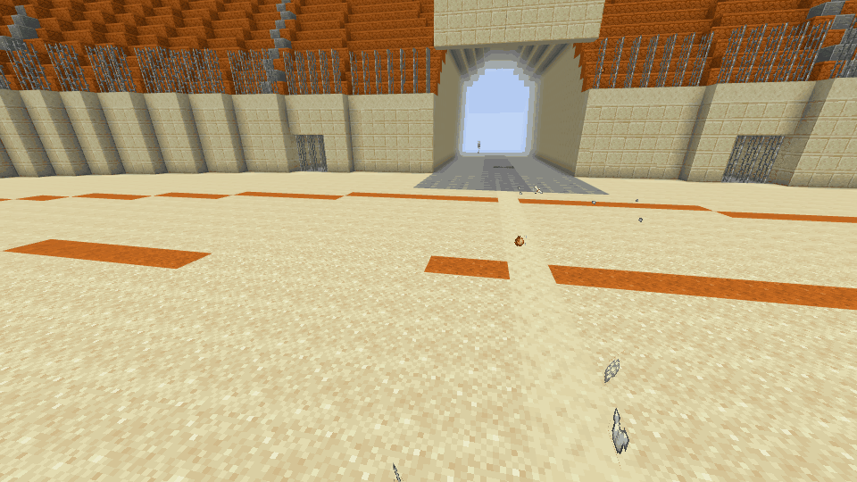
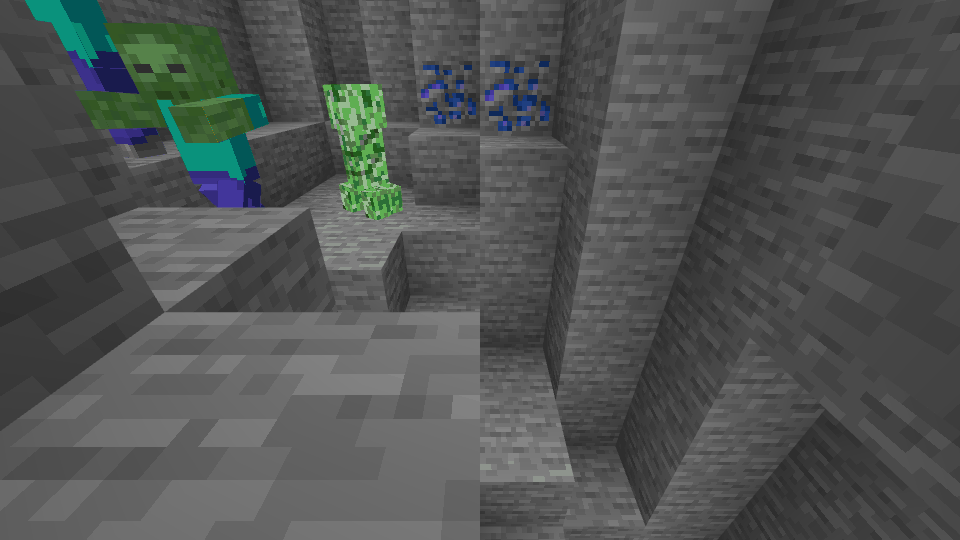
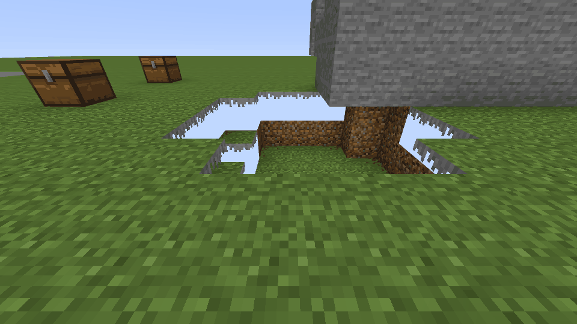
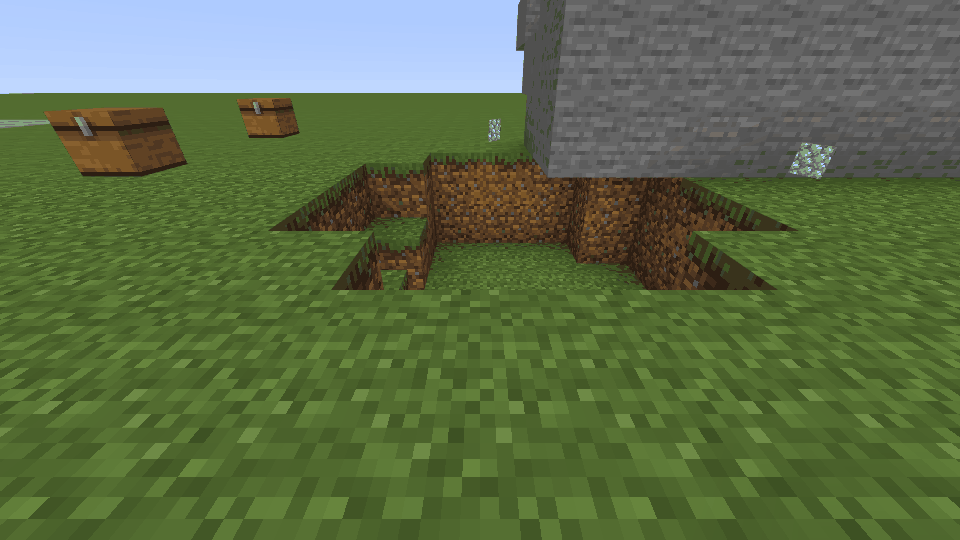
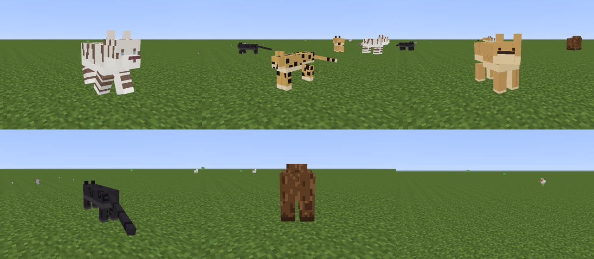

# Crew camera fidelity audit (2026-10-27)

How far the rendered crew camera is from the game, per category the lab uses,
and what was fixed first. Skin geometry is out of scope (tracked separately).

## Method and its limit

- Scene: the live prd crew units, read through `kubectl port-forward` to each
  unit's `/camera` (read-only, no credentials). The lab carries a block gallery,
  the arena, farm plots, caves and about 70 mobs and players, so one pass covers
  the blocks and mobs the lab actually uses: **468 distinct block names, about 20 entity
  types** (counted from the page's own material and entity tables, not guessed).
- Capture: `minecraft/crew/loadtest/shots.mjs` (headless Chrome on the same
  Playwright setup the wall load test uses). It can pin the viewpoint to a world
  position and serve a locally built atlas and mesher over a live scene, which is
  how the before/after pairs below were made.
- **Limit: no retail client was available to this session**, so the reference is
  the game's known geometry plus the pack data itself (alpha channels, model
  tables), not a retail screenshot taken at the same spot. A row marked pass
  means "matches what the game draws as far as the data and screenshots show";
  the owner's retail side-by-side is still the sign-off for the 95% target.
- Textures come from `bedrock-samples` at runtime; nothing from the pack is
  committed. The screenshots are renders of the camera, as the earlier ones in
  `docs/specs/assets` are.

## Result table

| Category | Result | Evidence |
|---|---|---|
| Full-cube blocks (stone, ores, planks, logs, concrete, terracotta, glazed, wool) | pass |  |
| Grass block sides (every cliff, pit and terrace edge) | **fail, fixed** | before/after below |
| Stairs, slabs, doors, trapdoors, snow layers, fences, walls, panes, bars | pass (state comes through the block name) | arena photo |
| Chests, beds, enchanting table, soul sand, cactus, daylight detector, sculk sensors, decorated pot, redstone dust | **fail (drawn as full cubes), fixed** | chests photo |
| Cross plants and flowers | pass | scenes |
| Cave vines, eyeblossoms, pale hanging moss, small dripleaf | **fail (cube with holes), fixed** | atlas data: 40-90% transparent tiles on a cube |
| Chains, copper lanterns, trip wire, piston helper blocks, sea lantern | **fail (cube of a decal / flat colour / invisible block shown), fixed** | table lookup: 6 lab names had no tile |
| Anvil, bell, grindstone, lectern, composter, beacon, lightning rods, copper grates, big dripleaf, cocoa, vault | fail | cubes with holes or wrong outline; follow-up |
| Block entities: chest lids/latches, signs and their text, banners, heads, beds | fail | no model path for block entities; follow-up |
| Glass, ice, water | pass (blended; water surface 2/16 low) | scenes |
| Water colour, foliage and grass tint | partial | one climate everywhere: crew gets no biome data |
| Lighting | fail | faces carry fixed per-direction shade and corner occlusion; no block or sky light, so caves and nights are as bright as noon |
| Sky | partial | gradient and fog only; no sun, moon, stars or clouds |
| Mob models and default textures (zombie, creeper, skeleton, spider, cow, pig, sheep, chicken, bat, witch, villagers, phantom, armadillo, glow squid) | pass |  |
| Mob variants (villager professions, horse markings, saddles, glowing eyes, charged creeper) | fail | one fixed look per type; follow-up |
| Armour on players, zombies and armour stands | pass for layers, fail for enchant glint and trims | armour frame uses the pack's `_1`/`_2` textures |
| Player skins | pass (skin geometry out of scope) | |
| Dropped items | partial | flat icon; the game draws block items as small cubes |
| Particles, breaking cracks, fire and portal animation | fail | not drawn; low value |

### The biggest gap: grass sides

The pack's grass side is an overlay mask: an opaque grey fringe on top and a
transparent lower body whose RGB is already dirt. The camera discarded the
transparent part, so every exposed grass side was a hole through which the sky
showed, and the fringe was grey. Pits, cliffs and terraces all showed it.

| Before | After |
|---|---|
|  |  |

Fix: the atlas build bakes that tile once (dirt kept, fringe coloured for the
camera's one climate) into a tile of its own. Cost: one extra 16x16 atlas layer,
no per-frame work.

## Ranked fix list

1. Grass block sides. Done.
2. Blocks drawn as full cubes whose real shape is smaller (chest, bed, soul sand,
   enchanting table, cactus and the rest above), and cube-with-hole plants. Done
   for the table above; anvil, bell, grindstone, lectern and composter need real
   models.
3. Block names with no tile or an invisible helper (sea lantern alias, chains,
   lanterns, trip wire, piston helpers). Done.
4. Lighting (block and sky light) and a sun/moon sky. Largest remaining visual
   gap, but needs light data the unit may not stream; needs its own spike.
5. Block entities (chest model, signs, banners, heads).
6. Mob variants and enchant glint.
7. Dropped block items as cubes.

## Render budget

The fixes add one atlas layer and replace six-face cubes by smaller boxes for a
handful of block types; plants become two crossed quads instead of a cube. None
adds per-frame work. The wall load test was not re-run for this change.

## Custom entities (2026-10-31)

The camera draws a pack's own entities as their real models when the unit is
started with `CAMERA_PACK_DIR` (a resource pack directory; the lab's wildlife
pack is `packs/lab-mods-wildlife/resource_pack`). Units decline the server's
resource pack, so before this a `gameops:tiger` was a coloured stand-in box.

Method: a throwaway RakNet preview server with the pack, a crew unit with the
camera on, headless Chrome (SwiftShader). Tests build the real pack as the
fixture (`atlas/pack_entities_test.go`, `camera/testdata/wildlife.test.mjs`).

| Aspect | Result | How it is driven |
|---|---|---|
| Geometry (format 1.12.0 `.geo.json`), six species | pass | same cube/UV pipeline as vanilla mobs, compiled into a second sheet served at `/v1/camera/pack.{png,json}`; no download, so it works where the vanilla atlas cannot be fetched |
| Texture variants (tiger orange/white, lion male/female, hyena regular/alpha) | pass | render controller `Array.skins[query.variant]`; the entity's Variant metadata rides in the high nibble of the entity-data colour byte |
| Female lion has no mane | pass (data and tests; mane bones emptied for variant 1) | render controller `part_visibility` |
| Walk | pass | `query.modified_distance_moved` and `modified_move_speed` come from the distance the drawn entity moved; legs swing, tail wags |
| Idle, head look | pass | `query.life_time`, `target_x/y_rotation` from head yaw and pitch |
| Sit | pass **only when the flag is sent** | `query.is_sitting` reads the sitting metadata flag. A console `event entity ... gameops:on_sit` (the only hook before real interaction exists) does **not** set that flag, so the camera correctly shows a standing animal. `?sit=1` forces the pose to inspect it; the recorder labels such clips |
| Attack | inferred, lunge not yet confirmed on video | BDS sent no swing for a tamed tiger's melee (no ActorEvent 4, no Animate packet reached the unit). The hub makes the nearest pack animal within 3.5 blocks swing when something is hurt, spaced 350 ms. An announced swing is honoured |

What is not drawn: shaders, particles, the `idle` animation's exact timing as
the game blends it (animations here are summed, not blended or weighted),
keyframed animation bones (only plain `[x, y, z]` expressions are read), and
position X is not mirrored as the game does (no pack animation uses it). The
walk speed scale (a full stride at about 5 blocks a second) is chosen, not read
from the game.
